# Primeira Onda OPS

[English](README.md) | **Português**

**A operação de uma escola de surf, organizada em um só lugar.**

Sistema em produção que conecta agenda, alunos, instrutores, pacotes e controle financeiro a um Portal do Aluno mobile-first. Desenvolvido para os fluxos reais de uma escola, com regras de negócio e permissões aplicadas no backend.

> Case público de um produto real. O código-fonte e a documentação operacional permanecem privados.

[Funcionalidades](#funcionalidades) · [Produto em telas](#produto-em-telas) · [Arquitetura](#arquitetura) · [Engenharia e qualidade](#engenharia-e-qualidade)

## O problema que o OPS resolve

Agendamentos, créditos e pagamentos distribuídos entre mensagens e controles isolados dificultam a visão da operação. A escola precisa saber quem vai fazer a aula, quem vai ensinar, quais créditos estão disponíveis e o que foi recebido — com cada pessoa acessando apenas o que lhe cabe.

O OPS reúne esse trabalho em uma aplicação acessível pelo celular, com experiências próprias para gestão, instrutores e alunos.

## Funcionalidades

| Área | O que o sistema entrega |
|---|---|
| **Agenda e aulas** | Agendamento, reagendamento, cancelamento e conclusão; horários padrão e excepcionais; múltiplos alunos e instrutores por aula. |
| **Alunos e créditos** | Cadastro e busca de alunos, pacotes e aulas avulsas, acompanhamento de créditos disponíveis, reservados e utilizados. |
| **Portal do Aluno** | Consulta de aulas, pacotes e dados pessoais; solicitações de agendamento, reagendamento e cancelamento, com aprovação e contrapropostas. |
| **Equipe** | Acessos por perfil, agenda própria do instrutor e consulta de remuneração, repasses e histórico. |
| **Financeiro** | Registro de vendas e recebimentos, pagamentos pendentes, remuneração e repasses, com resumos operacionais e financeiros. |
| **Comunicação** | Web Push com avisos operacionais e acesso ao contexto da notificação. |
| **Experiência PWA** | Instalação em dispositivos compatíveis, atualização obrigatória quando uma nova versão está pronta e novidades contextualizadas por perfil. |
| **Manutenção técnica** | Bloqueio temporário de escritas operacionais no backend e tela de manutenção, com controle técnico independente da aplicação. |

No portal, pedidos passam pela gestão; uma proposta de outra data ou horário requer aceite explícito do aluno. O financeiro registra e acompanha as operações da escola; **não inclui checkout online pelo aluno**.

## Produto em telas

Todas as capturas utilizam **dados fictícios criados para demonstração**.

### Portal do Aluno — pensado para o celular

Próxima aula, solicitação de agendamento e consulta de créditos em uma navegação própria para o aluno.

| Início | Solicitar agendamento | Pacotes e avulsas |
|:---:|:---:|:---:|
| 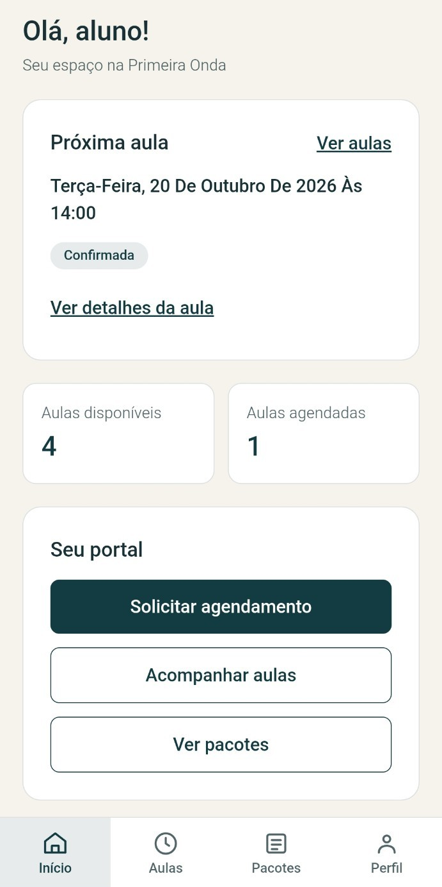 | 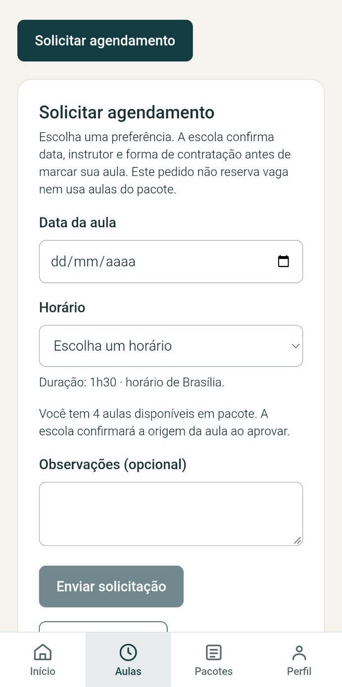 | 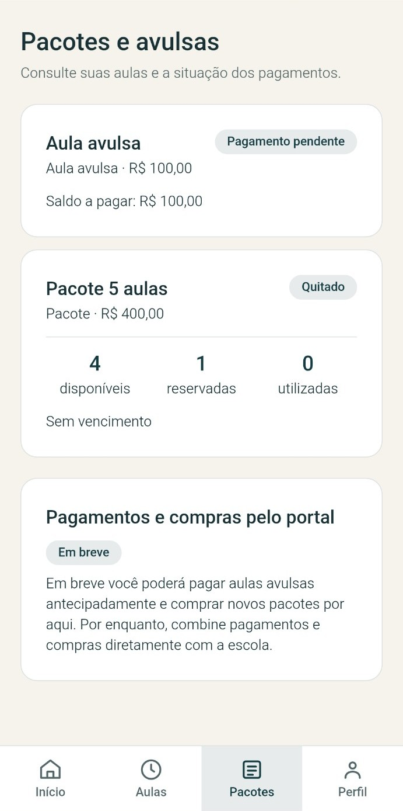 |

Histórico de aulas e edição dos dados pessoais completam a experiência do aluno.

| Minhas aulas | Perfil |
|:---:|:---:|
| 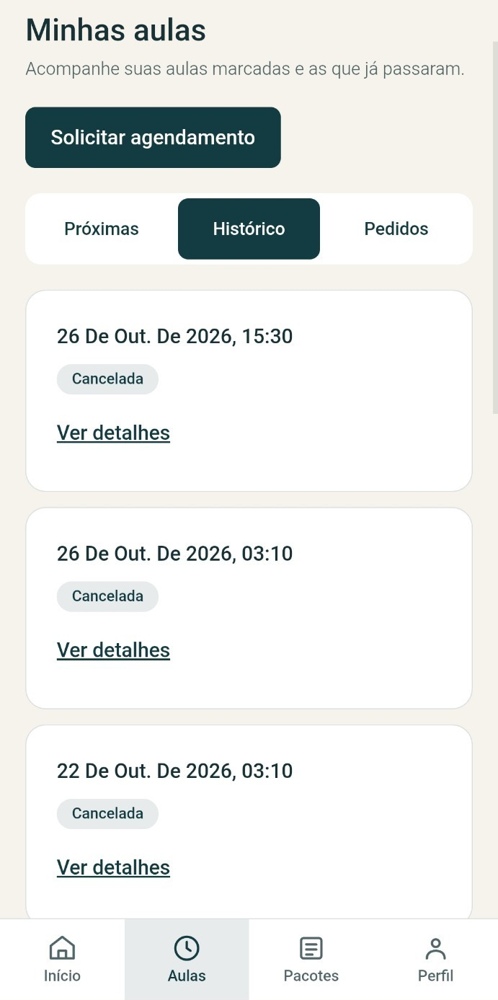 | 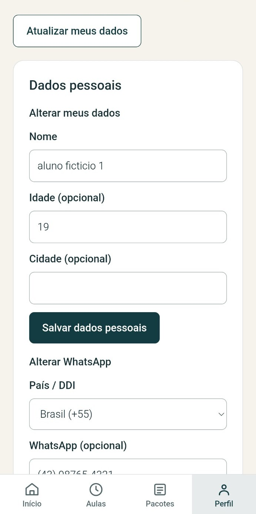 |

### Gestão — agenda e aulas

Organize horários, aulas, alunos e instrutores em uma visão clara da agenda da escola.

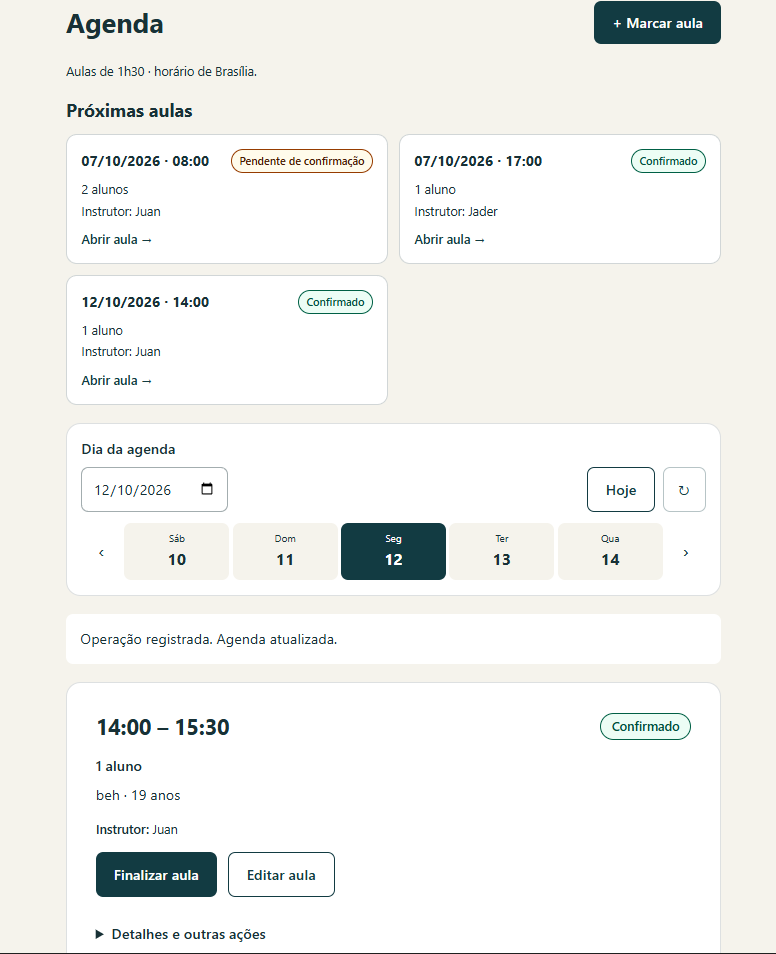

Explorar financeiro, alunos, pacotes e instrutores

Vendas, recebimentos, remuneração e repasses têm significados distintos e são apresentados separadamente.

| Financeiro | Alunos | Pacotes e avulsas |
|:---:|:---:|:---:|
| 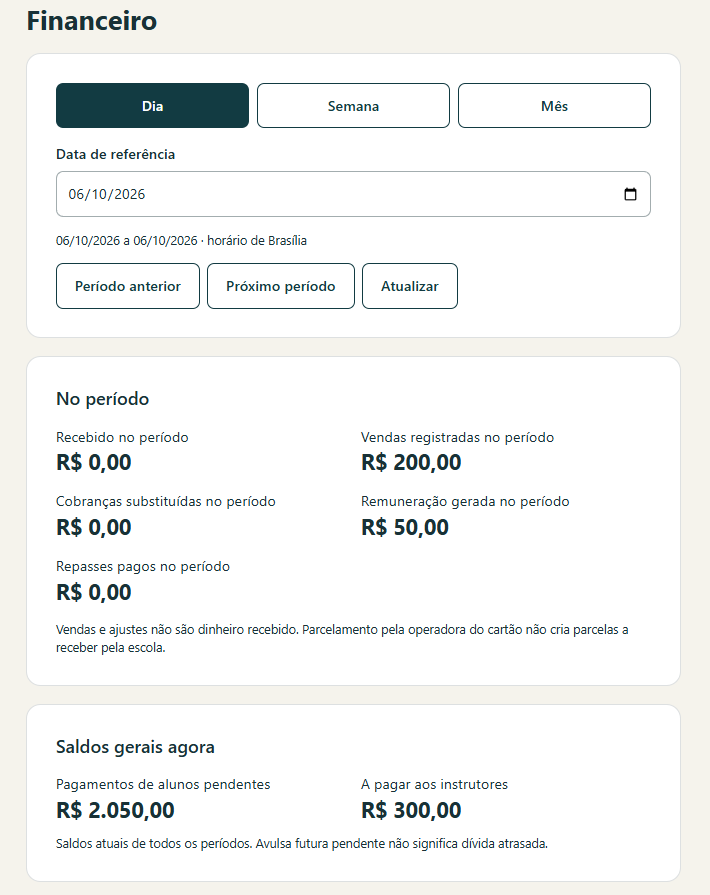 | 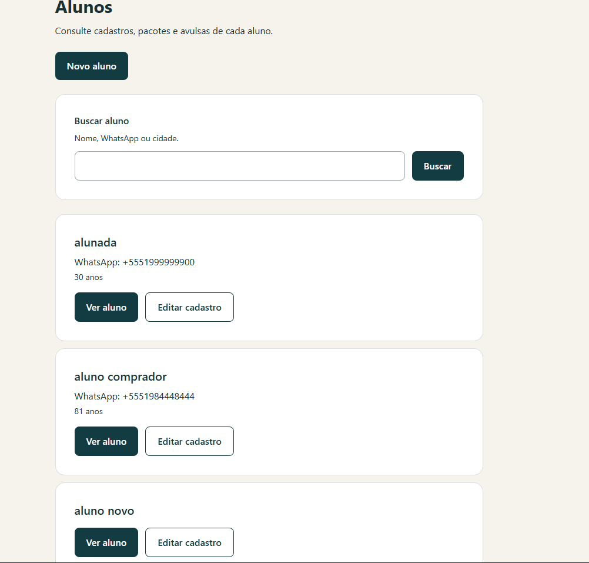 | 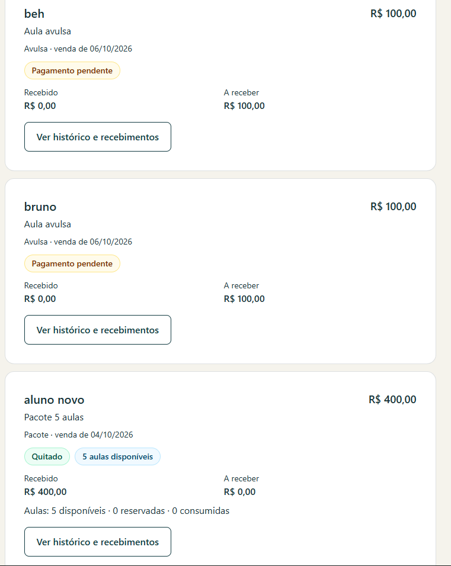 |

| Instrutores | Saldo e histórico do instrutor |
|:---:|:---:|
| 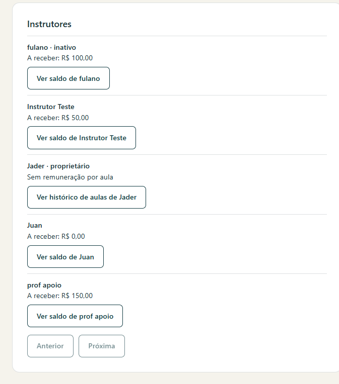 | 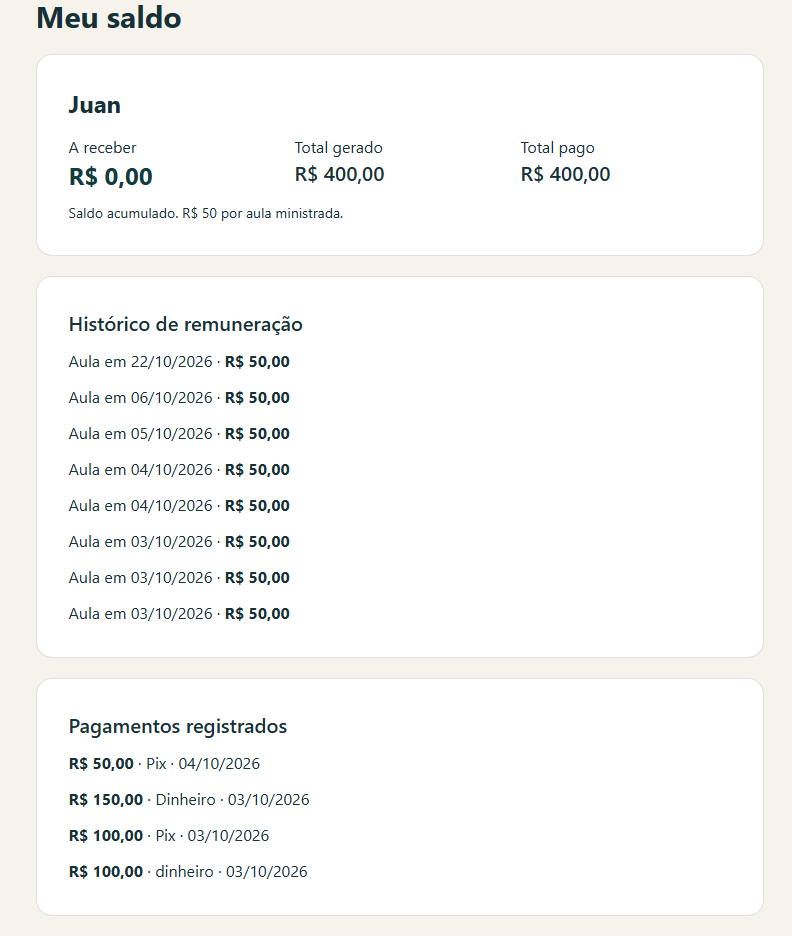 |

As capturas ilustram a interface do produto. O case não oferece acesso a contas ou dados de produção.

## Experiência mobile-first e PWA

- **Instalação em dispositivos compatíveis:** acesso como aplicativo, com layout responsivo também no desktop.
- **Atualização segura:** uma nova versão pronta exige atualização; rascunhos e operações pendentes ou incertas bloqueiam a troca até que seja seguro continuar, com coordenação entre abas.
- **Navegação Push protegida:** o destino abre diretamente quando permitido. Com edição ou operação pendente, a atividade é preservada e o usuário escolhe quando abrir a notificação.
- **Novidades relevantes:** consulta voluntária de novidades e histórico filtrados para gestão, instrutor ou aluno, associados à versão instalada.
- **Manutenção real:** proteção no servidor durante intervenções técnicas, com uma mensagem clara para os usuários.

A PWA armazena assets estáticos; respostas de autenticação e dados operacionais não são cacheadas para uso offline. A operação do sistema exige conexão.

## Arquitetura

| Camada | Tecnologias e responsabilidades |
|---|---|
| **Interface** | React, TypeScript, Vite, Tailwind CSS e React Router. |
| **Identidade e dados** | Supabase Auth e PostgreSQL, com Row Level Security, constraints, funções e operações transacionais. |
| **Serviços de backend** | Supabase Edge Functions para operações privilegiadas e processamento de notificações. |
| **Notificações** | Web Push com VAPID, fila de eventos e controle de entregas no PostgreSQL; processamento com pg_cron e pg_net. |
| **Entrega** | Cloudflare Pages, PWA e Service Worker para assets estáticos e atualização controlada. |
| **Qualidade** | Vitest, Testing Library, testes SQL, ESLint, TypeScript e validações de build/PWA. |

O navegador recebe apenas configuração pública. Credenciais privilegiadas e autorização de operações sensíveis ficam no backend.

## Engenharia e qualidade

### Desafios resolvidos

| Desafio | Abordagem |
|---|---|
| **Manter créditos e valores coerentes** | Reserva e consumo de créditos, transações e idempotência; vendas, recebimentos e repasses tratados separadamente. |
| **Restringir acesso conforme a função** | Autorização no servidor e RLS, com visões próprias para gestão, instrutor e aluno. |
| **Atualizar sem interromper uma atividade protegida** | Admissão de atualização entre abas, identificação de documento e Service Worker e proteção de formulários e operações. |
| **Abrir notificações com segurança** | Revalidação de sessão e permissões antes da navegação, respeitando edição, manutenção e atualização. |
| **Preservar o histórico do negócio** | Compras, preços e movimentos registrados mantêm suas condições históricas. |

### Qualidade como parte da entrega

A validação local registrada reúne **983 testes automatizados em 141 arquivos**, com lint, TypeScript, build e validações PWA aprovados.

As práticas incluem testes unitários e de integração, comportamento da interface, autorização, regressões e cenários de concorrência em PostgreSQL local. Mudanças críticas são verificadas pelo ciclo **RED → GREEN → REGRESSION**.

A entrega combina ambientes separados, artefatos identificados e verificação de integridade para tornar cada publicação rastreável.

## Competências demonstradas

- Desenvolvimento full-stack orientado a uma operação real.
- Modelagem de dados, regras de negócio e controle de acesso.
- Experiência mobile-first para públicos com necessidades distintas.
- Integração entre PWA, notificações e serviços de backend.
- Testes de regressão e processo de entrega controlado.

## Desenvolvedor

**Juan Vieira** · Software Developer

[Perfil no GitHub](https://github.com/juanbvdev)
